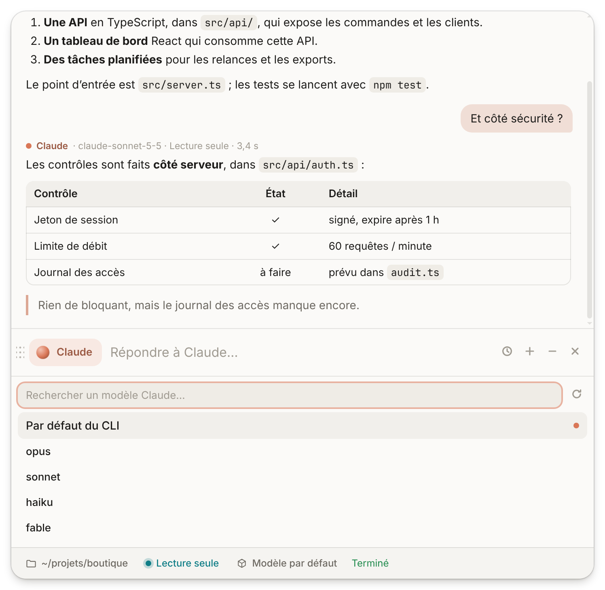

<div align="center">


# Aska

**One shortcut, one field, and your AI agents answer.**

Claude Code, Codex, GitHub Copilot and Cursor in a single small window,<br>
driven by their official CLIs. Linux, macOS and Windows.

[](https://github.com/JunsyG92/aska/actions/workflows/ci.yml)
[](https://github.com/JunsyG92/aska/releases)
[](LICENSE)


</div>

## At a glance

- ⌨️ **`Ctrl+Alt+Space`** opens the window, wherever you are. `Tab` switches agent, `Enter` sends.
- ✂️ **Ask about what you selected**: `Ctrl+Alt+Shift+Space` opens Aska with the text selected in any window quoted in the field, ready for your question.
- 💬 **A real conversation thread**: each message keeps the context of the previous ones, even if you switch agents along the way.
- 🗂️ **Tabs that work in parallel**: one conversation per topic, and Claude can think in one while you ask Codex something in another.
- 🔌 **Your CLIs, your accounts**: Aska calls no API and stores no key. It runs the CLIs already installed and signed in on your machine, with their MCP servers and skills.
- 🛡️ **Read-only by default**: the agent changes nothing until you switch modes, and never without your approval for the folder.
- 📌 **Out of the way or always there**: a click outside hides the chat; pinned, it stays on top where you put it. Minimized to a pill, it shows you how the agent is doing.
- 🔔 **Notified as soon as the AI answers**: a system notification (agent and start of the answer) when the chat is hidden or minimized; one click brings you back to the conversation.
- ⌨️ **`/` commands**: `/model`, `/mode`, `/cd`, `/codex …` from the field, and your own prompts as commands (`/trad bonjour`).
- 🌗 **Light or dark**, following your system theme.
- 🌐 **English or French**: the interface follows your system language (`"language"` in the config to force one).

## Overview

<table>
<tr>
<td width="50%" valign="top">

**Markdown answers**<br>
Tables, lists, quotes, links, and code blocks with a "Copy" button.

<picture><source media="(prefers-color-scheme: dark)" srcset="docs/chat-dark.png"></picture>

</td>
<td width="50%" valign="top">

**History**<br>
Conversations grouped by date, with preview, agents involved and search.

<picture><source media="(prefers-color-scheme: dark)" srcset="docs/historique-dark.png"></picture>

</td>
</tr>
<tr>
<td valign="top">

**Model picker**<br>
The list comes from the CLI itself and can be filtered from the keyboard.

<picture><source media="(prefers-color-scheme: dark)" srcset="docs/modeles-dark.png"></picture>

</td>
<td valign="top">

**Approval before writing**<br>
Modifying a folder needs your go-ahead, once or for good.

<picture><source media="(prefers-color-scheme: dark)" srcset="docs/accord-dark.png"></picture>

</td>
</tr>
<tr>
<td valign="top">

**Code ready to copy**

<picture><source media="(prefers-color-scheme: dark)" srcset="docs/code-dark.png"></picture>

</td>
<td valign="top">

**Minimized to a pill**<br>
The agent keeps going, the pill shows how far along it is.

<picture><source media="(prefers-color-scheme: dark)" srcset="docs/pastille-dark.png"></picture>

</td>
</tr>
</table>

## Installation

You need **Node.js ≥ 20** and at least one agent CLI installed and signed in:

| Agent | Installation |
| --- | --- |
| Claude Code | `npm i -g @anthropic-ai/claude-code` |
| Codex | `npm i -g @openai/codex` |
| GitHub Copilot | `npm i -g @github/copilot` |
| Cursor | see [cursor.com/cli](https://cursor.com/cli) |

### Linux

```sh
git clone https://github.com/JunsyG92/aska.git && cd aska
./scripts/install.sh                    # X11: global shortcuts Ctrl+Alt+Space and Ctrl+Alt+Shift+Space
./scripts/install.sh --gnome-shortcut   # GNOME / Wayland: shortcuts registered in GNOME
aska --hidden &                         # or log in again (autostart)
```

- **Ubuntu 24.04+**: the script offers to configure the Electron sandbox (asks for your `sudo` password). Without it, Aska does not start; `--sandbox-fix` does it without asking.
- **Wayland**: an application cannot always grab a global shortcut. If `Ctrl+Alt+Space` does nothing, bind the command `aska --toggle` to a shortcut in your desktop's keyboard settings (KDE, Sway, Hyprland...) and set `"shortcut": false` in the configuration. Same for `Ctrl+Alt+Shift+Space`: bind `aska --selection` and set `"selectionShortcut": false`.
- **Wayland**: the `aska` command runs Aska through XWayland (`--ozone-platform=x11`). As a native Wayland client, the window gets no keyboard focus when a shortcut shows it on GNOME, and hides as soon as you drag it. `aska --ozone-platform=wayland` still forces native Wayland. If you installed Aska before this change, run `./scripts/install.sh` again to update the command, then `aska --restart`.

### macOS

```sh
git clone https://github.com/JunsyG92/aska.git && cd aska
./scripts/install.sh                    # global shortcut ⌃⌥Space (Ctrl+Option+Space)
aska --hidden &                         # or log in again (autostart)
```

No `sudo` needed. The script puts an `aska` command in `~/.local/bin`, creates `~/Applications/Aska.app` (Spotlight, Launchpad) and starts Aska when you log in (LaunchAgent; `--no-autostart` to skip that). Aska has no Dock icon.

- **PATH**: `~/.local/bin` is not in the default macOS `PATH`. Add it: `echo 'export PATH="$HOME/.local/bin:$PATH"' >> ~/.zshrc`.
- **Shortcut**: the window shortcuts use `Ctrl`, not `⌘`. If `⌃⌥Space` already switches input sources (System Settings → Keyboard → Keyboard Shortcuts → Input Sources), turn that shortcut off or pick another one with `"shortcut"`.
- **Notifications**: they show up as "Electron"; allow them in System Settings → Notifications.
- CLIs installed with Homebrew (`/opt/homebrew/bin`) are found even when Aska is started outside a terminal.

### Windows 10 / 11

```powershell
git clone https://github.com/JunsyG92/aska.git; cd aska
powershell -ExecutionPolicy Bypass -File scripts\install.ps1
```

No administrator rights needed. The script creates an "Aska" shortcut in the Start menu, starts Aska when you log in (`-NoAutostart` to skip that) and puts an `aska` command in `%LOCALAPPDATA%\aska\bin`.

### Check the installation

```sh
aska --help
```

The help lists the options, the shortcuts, and above all **the status of each agent**: the CLI found and its path, or why it is missing.

| Command | Effect |
| --- | --- |
| `aska` / `aska --toggle` | shows or hides the window (starts the app if needed) |
| `aska --selection` | shows the window with the selected text quoted in the field (see [Ask about the selection](#ask-about-the-selection)) |
| `aska --hidden` | starts in the background |
| `aska --reload` | reloads the configuration |
| `aska --restart` | restarts Aska (after an update) |
| `aska --quit` | quits |
| `aska --help` / `--version` | help and diagnostics / version |

## Shortcuts

| Key | Action |
| --- | --- |
| `Ctrl+Alt+Space` | show / hide the window (global shortcut, configurable) |
| `Ctrl+Alt+Shift+Space` | ask about the text selected in another window (global shortcut, configurable) |
| `Enter` | send · `Shift+Enter`: new line |
| `Tab` | next agent |
| `Shift+Tab` | next permission mode |
| `Ctrl+Shift+M` | pick the model |
| `Ctrl+T` (or `Ctrl+N`, `Ctrl+L`) | new tab |
| `Ctrl+W` | close the tab (twice if it is working: its request is cancelled) |
| `Ctrl+Tab` / `Ctrl+Shift+Tab` | next / previous tab (also `Ctrl+PgDn` / `Ctrl+PgUp`) |
| `Ctrl+1` … `Ctrl+9` | go to tab 1 to 8, `Ctrl+9`: the last one |
| `Ctrl+H` | history: type to search, `Enter` to open, `Del` twice to delete |
| `Ctrl+O` | working folder (right-click the folder: back to the scratch space) |
| `↑` / `↓` | recall a message already sent |
| `Ctrl+Shift+C` | copy the last answer |
| `Ctrl+R` | after denied actions: run the request again in the next mode (the button of the last answer) |
| `Ctrl+M` | minimize to a pill / expand |
| `Ctrl+P` | pin: the chat stays visible when you click elsewhere |
| `Ctrl+,` | settings |
| `/` | [commands](#commands): `/model sonnet`, `/cd ~/project`, `/codex …`, and your own |
| `Esc` | cancel the current request, otherwise hide |

The shortcuts that use `Ctrl` can be changed in the [settings](#settings) or with `"keybindings"` in the [configuration](#configuration); the tooltips and `aska --help` show the ones you chose.

A click outside the chat hides it; the agent keeps working. To keep it visible, pin it (📌 or `Ctrl+P`): the choice is remembered. Minimized to a pill, it always stays visible. The window is moved with the handle on the left or the bottom bar, and its position is remembered.

While Aska is running, its icon stays in the system tray (top right on GNOME).
A green dot is added while a request is running, and the tooltip says which
agents are working. Its menu shows or hides the chat, opens a new tab, cancels
the running requests and quits Aska. On GNOME, a click opens this menu and a
double-click shows or hides the chat directly; elsewhere, a left click shows or
hides the chat and a right click opens the menu. `"tray": false` in the config
removes it.

### Commands

Type `/` in the field: a list of commands opens above it (`↑` `↓` to choose, `Tab` to complete, `Enter` to run, `Esc` to close). They are run by Aska and never sent to the agent, so they work the same with every agent.

| Command | Action |
| --- | --- |
| `/help` | list the commands |
| `/new` (or `/clear`), `/close` | new tab, close the tab |
| `/agent codex`, or just `/codex` | switch agent; `/codex explain this` also sends the rest to it |
| `/mode read` · `edit` · `auto` | change the permission mode |
| `/model sonnet` | pick the model (`/model default`: the CLI's own; `/model` alone opens the picker) |
| `/cd ~/project` | change the working folder (`~` and relative paths accepted; `/cd` alone opens the picker) |
| `/retry` | send the last request of the conversation again |
| `/copy`, `/history`, `/settings`, `/pin`, `/mini` | same as their shortcuts |

Your own commands go in `"commands"` in the [configuration](#configuration): a name and the prompt it sends, with `{input}` replaced by what you type after the name (`/trad bonjour` sends `Translate into English: bonjour`; without `{input}`, that text is added after a blank line). They show in the list with their `description`, or the first line of the prompt. An object can also pick the `agent` and the permission `mode` (switched in the window, as if you did it) and a `model` for that request only (`null`: the CLI's default). Names are lowercase letters, digits and `-`; a name taken by Aska's commands or by an agent is refused, and the window and `aska --help` say why.

Only `/word` followed by a space or the end is a command: `/etc/hosts, what is it?` is a message. To send a message that starts with a command name (an agent's own `/review`, say), double the slash: `//review` sends `/review`.

### Ask about the selection

Select some text anywhere (a page, an error in a terminal, a mail), then press `Ctrl+Alt+Shift+Space`: Aska shows up with that text quoted in the field (`> ` in front of each line), above your draft, and you type the question. Nothing is sent until you press `Enter`.

- **Linux**: the highlighted text (the primary selection), no need to copy it. If nothing is highlighted, the clipboard, and the window says so.
- **macOS and Windows**: they have no primary selection: copy the text first (`Cmd+C` / `Ctrl+C`), then press the shortcut.
- The text is cleaned (control characters and terminal colors dropped) and cut at 20,000 characters.
- `"selectionShortcut"` in the configuration (or the settings) changes it; `false` removes it. `aska --selection` does the same from a script or a desktop shortcut.

## Bots

A bot is an agent with a personality: a name, instructions, and settings of its own. Type `@` in the field to list them, `@trad hello` to switch the tab to the bot and send the rest (`@trad` alone just switches). Each tab keeps its own bot, shown by its avatar before the agent, in the answers and on the tab; `@` then `Enter`, or **No bot** in the list, goes back to the agent alone. `/agent` changes the agent and keeps the bot. `@@text` sends `@text` as is, and `@` is only read at the start of a message.

At the first launch, Aska copies five example bots, in the interface's language and for your default agent: translator, proofreader, explainer, commit message and code reviewer. They start read-only; the commit one may also write and run `git add` and `git commit` when you switch it to Edit and ask it to commit. They are yours: edit them, delete them or turn them off, in the **Bots** tab of the settings (name, avatar or a picture of your own, color, model, maximum and starting mode, allowed commands, personality) or in their files. Aska never copies them again, so an update never touches them.

Each bot is a folder in `~/.aska/bots/<id>/` (`%USERPROFILE%\.aska\bots\<id>\` on Windows); the folder name is what you type after `@`:

```text
~/.aska/bots/trad/
  bot.json    settings
  SOUL.md     personality: instructions in plain text (required)
  MEMORY.md   things to remember, one per line, newest last (optional)
```

```json
{
  "label": "Translator",
  "description": "Into English, or into French",
  "agent": "claude",
  "model": "haiku",
  "mode": "read",
  "maxMode": "read",
  "avatar": { "variant": 2 }
}
```

| Field | Meaning |
| --- | --- |
| `agent` | agent it runs on (required; it must be installed and enabled) |
| `label`, `description` | name shown (24 characters) and description in the `@` list |
| `model` | model used on its own agent (a model picked by hand holds for the tab only) |
| `mode`, `maxMode` | starting mode and ceiling, `read` by default; `auto` needs `"allowAutoMode": true` and is never the starting mode. A bot can never change its own ceiling (`~/.aska` is out of reach of every write mode) |
| `allow` | commands the bot may run without asking, in a writing mode: `["git add", "git commit", "gh workflow run deploy-qa.yml"]`. Each one is an exact prefix of 1 to 6 words: it allows that command with any arguments after it, nothing else (a workflow is always named). Never a shell, an interpreter, `rm`, `sudo`, `curl`, `git push`, `git reset`, `gh api`… Forced pushes and remote deletions are always denied. Claude only for now (`--allowedTools`, `--disallowedTools`); the other agents ignore it |
| `cwd` | working folder (absolute path): picking the bot with `@` moves the tab there, as `/cd` does; checked as any folder |
| `color` | `#rrggbb`; by default the color of its avatar |
| `avatar` | `variant` (another robot for the same name), `shape` and `emblem` (`auto`, `none` or a name; `auto` guesses it from the bot's name) |
| `enabled` | `false` turns the bot off |

- **Claude** gets the personality as a system prompt (`--append-system-prompt`). The other agents get it as a `<bot>` block before the conversation. A custom agent can name its own option with `"systemFlag"`.
- `SOUL.md` is sent with every request: a warning over 4,000 characters, the bot is refused over 8,000. `MEMORY.md` is cut to its newest entries (6,000 characters), with a warning; it is never cut silently.
- A Claude session is only resumed with the same bot and the same text: after editing `SOUL.md` or `MEMORY.md`, the conversation goes on with its history sent again.
- Bots are read at startup and by `aska --reload`. Like the configuration, a file that belongs to another user or that others can write is refused; problems show in the window and in `aska --help`, which also lists the bots.
- `~/.aska` is a protected folder: no agent can write there, so a bot cannot change its own `maxMode`.

## Settings

`Ctrl+,`, the ⚙ button or "Settings…" in the tray icon menu open the settings in the window, in three tabs. **General**: language, default agent and mode, time limit, always on top, tray icon, notifications, saved conversations. **Shortcuts**: the global shortcuts (show / hide, ask about the selection), the shortcuts inside the window (press the keys to record one), and the fixed keys. **Bots**: create, edit, turn off and delete the [bots](#bots). **Save** writes them to `config.json` (only what differs from the defaults, `600` rights) and applies them at once; **Cancel** or `Esc` discards the changes; **Reset all to defaults** fills the form with the defaults, to save.

- On GNOME, the global shortcuts are the "Aska" (`aska --toggle`) and "Aska (selection)" (`aska --selection`) entries of the GNOME custom keyboard shortcuts: the settings change them there, since an application cannot grab a global shortcut under Wayland.
- Agents, their programs and arguments, `envPassthrough` and the autonomous mode stay in `config.json`, edited by hand: they decide which programs run, so the window cannot change them.
- A value the main process refuses (shortcut already used, reserved combo…) is shown next to its field, and nothing is saved.

## Notifications

When an answer arrives while the chat is hidden or minimized to a pill, Aska sends a system notification: the agent, and the start of the answer as plain text (or the reason for a failure). Clicking the notification reopens the chat on the right conversation. The pill also shows "New answer" with a green dot, until you reopen the chat. A request you cancel never notifies.

| Option (`config.json`) | Effect |
| --- | --- |
| `"notify": "hidden"` | default: when the chat is hidden or minimized |
| `"notify": "unfocused"` | also when the chat is visible but you are working in another window |
| `"notify": "never"` | never |
| `"notifyPreview": false` | does not show the content of the answer (lock screen, screen sharing), only the conversation title |
| `"notifySound": false` | silent notification |

On Windows, notifications require a Start menu shortcut carrying the application identity: `scripts\install.ps1` creates it.

## Conversations

### Tabs

Each tab is a separate conversation, with its own working folder, agent, mode
and draft. **Tabs work at the same time**: start an analysis with Claude in one
tab, and ask Codex another question in another while it works (4 simultaneous
requests at most, 8 tabs).

- The tab bar only appears from two tabs on: with a single one, Aska stays a
  simple chat.
- A working tab shows a spinning ring; an answer that arrives in a tab you were
  not looking at makes it bold, with a green dot.
- Coming back to a tab while it answers resumes the live display.
- Opening a conversation from the history opens it in a tab (or activates the
  one where it is already open).
- Open tabs are reopened at the next start.


- **Follow-ups**: with Claude, Aska resumes the CLI session (`--resume`), which keeps the whole context, tools included. With the other agents, or if you switch agents mid-thread, the previous exchanges are injected back into the request (most recent first, up to about 24,000 characters).
- **Switching agents along the way**: so Codex can carry on a discussion started with Claude.
- **History**: each conversation is saved as a private file (200 at most) and reopens in its original working folder. `"savePrompts": false` disables all saving.

## Models

The model is chosen per agent and the choice is remembered. "CLI default" lets the agent decide. The list comes from the CLI itself, so it reflects your account and your version:

| Agent | Source of the list |
| --- | --- |
| Claude | the aliases `opus`, `sonnet`, `haiku`, plus those named by `claude --help` |
| Cursor | `cursor-agent --list-models` (you must be signed in: `cursor-agent login`) |
| Copilot | the list its ACP mode gives when a session opens (`copilot --acp`, in Aska's empty folder, nothing is sent) |
| Codex | the catalog Codex caches in `~/.codex/` |

Claude Code only names aliases: next to each one, and next to "CLI default", the picker shows the full name the CLI reported in its answers (`opus` · `claude-opus-5-5`), once you have used it.

Copilot saves the session opened to read its list; Aska removes it right away, but only if it is that session, in Aska's empty folder, and still empty.

The ↻ button queries the CLI again. If a CLI returns nothing, the picker says why in the CLI's own words (not signed in, for instance); type the model name in the search field ("Use ...") or declare your models in the configuration with `"models"`.

## Permission modes

As in Claude Code, each request runs in an explicit mode,
shown at the bottom of the panel. Aska always starts in **Read-only**.

| Mode | Claude | Codex | Copilot | Cursor |
| --- | --- | --- | --- | --- |
| **Read-only** | `--permission-mode plan --setting-sources user` | `--sandbox read-only` | `--deny-tool shell --deny-tool write` | `--mode ask` |
| **Edit** | `--permission-mode acceptEdits` | `--sandbox workspace-write` | `--allow-tool write --deny-tool shell` | - |
| **Autonomous** (disabled by default) | `--permission-mode auto` | `workspace-write` + network | `--allow-all-tools` + deny list | `--force` |

- Each CLI's own permission settings (e.g. `~/.claude/settings.json`)
  still apply: Aska only adds restrictions.
- **Autonomous** mode only shows up if `"allowAutoMode": true`. For Copilot and
  Cursor it is not isolated by a sandbox: keep it for throwaway folders.
- No mode uses `--dangerously-skip-permissions`, `--yolo` or the like,
  and these options are rejected if you add them in `extraArgs`.
- Without a UI, Cursor requires confirming trust in the folder
  (`--trust`). Aska does it automatically in its empty folder; elsewhere, it asks
  for your approval first, even in read-only.
- In read-only, Claude only loads your settings (`--setting-sources user`):
  the hooks and permissions in the `.claude/settings.json` of an unverified project
  do not run.
- When the agent reports denied actions (Claude does), the answer
  says so with a **Run again in "Edit" mode** button (the next wider mode the agent
  offers; Autonomous only if it is allowed). It switches the mode, then sends the
  same request again, as you would with `Shift+Tab` and `Enter`: the folder approval
  still applies, and your draft stays in the field. Only the last answer has it;
  `Ctrl+R` (the `rerun` shortcut) does the same from the keyboard.

## Security

In short: **no shell** ever sees the text of your requests, the agent only receives **the environment variables that concern it**, it can **only write in a folder you have allowed**, and the UI is **isolated** from the system.

<details>
<summary><b>The protections in detail, and their limits</b></summary>

<br>

**Running the CLIs**
- No shell: the binary is launched with an argument array; the prompt goes
  through stdin or as a single argument, and cannot become an option.
- The binary is resolved to an absolute path; it is rejected if it (or its folder) is
  writable by another user, and relative `PATH` entries are ignored.
- Filtered environment: only the base variables and those of the agent concerned
  (`ANTHROPIC_*` for Claude, `OPENAI_*` for Codex...) are passed on. Your other
  tokens (`AWS_*`, etc.) are not, unless added to `envPassthrough`.
- Maximum duration, output cap, and termination of the whole process group
  (SIGTERM then SIGKILL) on cancel.

**Folders**
- By default the agent works in an empty folder reserved for Aska.
- Writing to a folder needs your approval ("once" or "always").
- Writing is refused in `/`, your whole `~`, system folders and sensitive
  folders (`~/.ssh`, `~/.config`, `~/.gnupg`...).

**Application**
- Sandboxed UI, without Node (`contextIsolation`, `sandbox`), strict CSP,
  no remote resources, navigation and new windows blocked.
- Agent output is rendered as Markdown without ever interpreting HTML or loading
  remote images. Only `http(s)` links are clickable: they open in your
  browser, and their real destination is shown on hover.
- Every call from the UI is revalidated by the main process.
- `config.json` is ignored if it is writable by another user. On Linux, an ACL that only names the owner (common on domain-joined machines, where the mode then shows `670`) is not counted as such: the real ACL is read with `getfacl`.
- Private audit log (`~/.local/state/aska/history.jsonl`, 0600): date, agent,
  mode, folder, command, result. `"savePrompts": false` to keep requests out of it
  and not save conversations.
- Model names and session IDs are validated before reaching the command line.

**Known limits**
- Aska does not ask for approval action by action: the granularity is that
  of the chosen mode and the CLI's rules.
- In read-only, an agent can read any file your user can access
  (only Codex really isolates with a sandbox).
- The Copilot and Cursor CLI options change fast; if one changes, fix it
  in the configuration without waiting for an update.

**On macOS**
- Writing is also refused in macOS system folders (`/System`, `/Library`, `/Applications`, `/private/etc`…), checked on their real path.

**On Windows**
- CLIs installed by npm are `.cmd` launchers. Aska reads the launcher and runs `node.exe` directly on the target script, without going through `cmd.exe`, which would interpret `%`, `&`, `^`... in the text of your requests. A `.cmd` in another format is only accepted for harmless arguments; for an agent that receives the request as an argument (Copilot, Cursor), point to its `.exe` with `"bin"` in the configuration.
- Owner and permission (`600`) checks on files do not exist on Windows: Aska relies on the default protection of the user profile (`AppData`).
- Writing is refused at the root of a drive, in the whole profile, `AppData`, `Windows`, `Program Files` and `ProgramData`.

</details>

## Configuration

<details>
<summary><b>All <code>config.json</code> options</b></summary>

<br>

Linux and macOS: `~/.config/aska/config.json` (mode `600`). Windows: `%APPDATA%\aska\config.json`. Then `aska --reload`.

```json
{
  "shortcut": "Control+Alt+Space",
  "selectionShortcut": "Control+Alt+Shift+Space",
  "defaultAgent": "claude",
  "defaultMode": "read",
  "allowAutoMode": false,
  "timeoutSec": 600,
  "maxOutputKb": 2048,
  "savePrompts": true,
  "hideOnBlur": true,
  "alwaysOnTop": true,
  "tray": true,
  "notify": "hidden",
  "notifyPreview": true,
  "notifySound": true,
  "envPassthrough": [],
  "language": "auto",
  "keybindings": { "history": "Ctrl+J", "togglePin": false },
  "commands": {
    "trad": "Translate into English: {input}",
    "review": { "prompt": "Review the uncommitted changes of this folder.", "description": "Review the diff", "agent": "claude", "mode": "read", "model": "opus" }
  },
  "agents": {
    "claude": { "model": "sonnet", "extraArgs": ["--max-turns", "20"] },
    "codex": { "bin": "/home/me/.npm-global/bin/codex", "models": ["model-name-a", "model-name-b"] },
    "copilot": { "enabled": false },
    "gemini": {
      "label": "Gemini",
      "color": "#4285f4",
      "bin": "/usr/local/bin/gemini",
      "prompt": "arg",
      "promptFlag": "-p",
      "modes": { "read": ["--approval-mode", "default"] }
    }
  }
}
```

`hideOnBlur` sets the default behavior on an outside click (`true`: the chat hides; `false`: it stays, as if pinned); the pin in the UI changes it afterwards. `alwaysOnTop: false` lets the window go behind others. `tray: false` removes the system tray icon.

`keybindings` changes the shortcuts inside the window. Each action given replaces its default shortcuts: a shortcut (`"Ctrl+J"`), a list (`["Ctrl+J", "Alt+H"]`), or `false` for none. A shortcut is written like `Ctrl+Shift+M`, with `Ctrl`, `Shift`, `Alt` or `Meta` (`Cmd`), then one character or `Tab`, `PageUp`, `PageDown`, `Home`, `End`, `Insert`, `F1` to `F12`. It needs `Ctrl`, `Alt` or `Meta`; the text editing shortcuts (`Ctrl+C`, `Ctrl+V`, `Ctrl+X`, `Ctrl+A`, `Ctrl+Z`, `Ctrl+Y`) and `Ctrl+1` to `Ctrl+9` are kept. A shortcut taken from another action's defaults is removed there. Actions and defaults:

| Action | Default |
| --- | --- |
| `newTab` | `Ctrl+T`, `Ctrl+N`, `Ctrl+L` |
| `closeTab` | `Ctrl+W` |
| `nextTab` / `prevTab` | `Ctrl+Tab`, `Ctrl+PageDown` / `Ctrl+Shift+Tab`, `Ctrl+PageUp` |
| `history` | `Ctrl+H` |
| `pickDir` | `Ctrl+O` |
| `modelMenu` | `Ctrl+Shift+M` |
| `copyAnswer` | `Ctrl+Shift+C` |
| `rerun` | `Ctrl+R` |
| `toggleMini` | `Ctrl+M` |
| `togglePin` | `Ctrl+P` |
| `settings` | `Ctrl+,` |

`Enter`, `Shift+Enter`, `Tab`, `Shift+Tab`, `Esc`, the arrows, `Del` and `Ctrl+1` to `Ctrl+9` are fixed (the settings list them). An invalid or conflicting shortcut is ignored and reported in the window and in `aska --help`; an action left with no valid shortcut keeps its defaults.

`language` picks the interface language (window, notifications, `aska --help`): `"auto"` (default) follows the system language (French for any `fr*` locale, English otherwise), `"en"` or `"fr"` forces one. Requests sent to the agents are not translated.

A custom agent (like `gemini` above) declares its binary as an absolute
path and the arguments for each mode (`read`, `edit`, `auto`); `prompt` is
`"stdin"` or `"arg"`.

</details>

## Troubleshooting

Start with `aska --help`: the "Agents" section says which CLI is used, or why it is missing; the "Status" section says whether the chat hides on an outside click and whether an old version is still running.

<details>
<summary><b>Known issues</b></summary>

<br>

- **Wayland: no shortcut works in the window, or it disappears when I move it.** Aska is running as a native Wayland client. Run `./scripts/install.sh` again (the `aska` command then uses XWayland), then `aska --restart`.

- **The chat does not hide when I click outside, or a new feature is missing.**
  1. *After a `git pull`*, Aska must be relaunched: as long as the old process runs, `aska` only reopens it. Since this version, Aska detects and replaces an old instance by itself; with an even older version, run `aska --quit` once, then `aska`. `aska --restart` forces a restart.
  2. The chat may be **pinned** (📌 highlighted, `Ctrl+P` to toggle): a pinned chat stays visible. `Esc` hides it in any case.
  3. An old config contains `"hideOnBlur": false`: remove that line, or unpin with `Ctrl+P` (the UI choice wins).
  4. On Wayland, some desktops do not send focus loss to XWayland apps: in that case, use `Esc` or the ✕ button, and report the desktop in an issue.

- **Ubuntu 24.04+: "The SUID sandbox helper binary was found, but is not
  configured correctly" (killed by SIGTRAP)**: Ubuntu blocks the Electron
  sandbox. Run `./scripts/install.sh --sandbox-fix`: it installs an AppArmor
  profile (`/etc/apparmor.d/aska`, asks for your sudo password) that allows this
  sandbox for Aska's Electron binary only. If you move the Aska folder,
  run the command again. Do not run Aska with `--no-sandbox`.

- **"GitHub Copilot CLI was not found"**: the `copilot` command found is the
  launcher installed by VS Code, not the CLI. Install the real CLI
  (`npm i -g @github/copilot`, then run `copilot` once in a terminal to
  sign in). If it is installed outside your session's `PATH`
  (nvm, for example), give its path: `"agents": { "copilot": { "bin": "/absolute/path/copilot" } }`.
- **An agent does not show up**: same cause, its binary is not in the `PATH`
  of the graphical session. Give its path with `"bin"`, then `aska --reload`.
- **The icon does not show up in the top bar (GNOME)**: GNOME only shows these
  icons with the *AppIndicator and KStatusNotifierItem Support* extension.
  Ubuntu enables it by default; elsewhere (Fedora, Debian…), install it
  (`gnome-shell-extension-appindicator`), then log in again.

</details>

## Contributing

Contributions are welcome! The repository follows **GitHub Flow**: `main` is
protected, every change comes through a reviewed PR, tested on Linux, macOS and
Windows, then squash-merged. Releases and the [CHANGELOG](CHANGELOG.md)
are generated automatically from PR titles ([Conventional Commits](https://www.conventionalcommits.org/)).

```sh
git switch -c feat/my-feature
npm install && npm run check        # lint + unit tests
git push -u origin feat/my-feature
# then a PR to main, titled for example "feat(ui): shortcut to pin the chat"
```

Everything is detailed in [CONTRIBUTING.md](CONTRIBUTING.md). Found a security flaw?
See [SECURITY.md](SECURITY.md), never a public issue. The project is under the
[MIT license](LICENSE) and follows a [code of conduct](CODE_OF_CONDUCT.md).

## Development

```sh
npm install
npm start                               # runs the app
npm run lint                            # ESLint
npm test                                # unit tests
xvfb-run -a npm run test:e2e            # end-to-end test, with fake CLIs (macOS, Windows: npm run test:e2e)
./scripts/tray-icons.sh                 # regenerates the system tray icons (rsvg-convert)
```

Every PR runs these checks on Linux, macOS and Windows, plus a CodeQL analysis. The images on this page are generated from the real application by `scripts/readme-media.js`.
