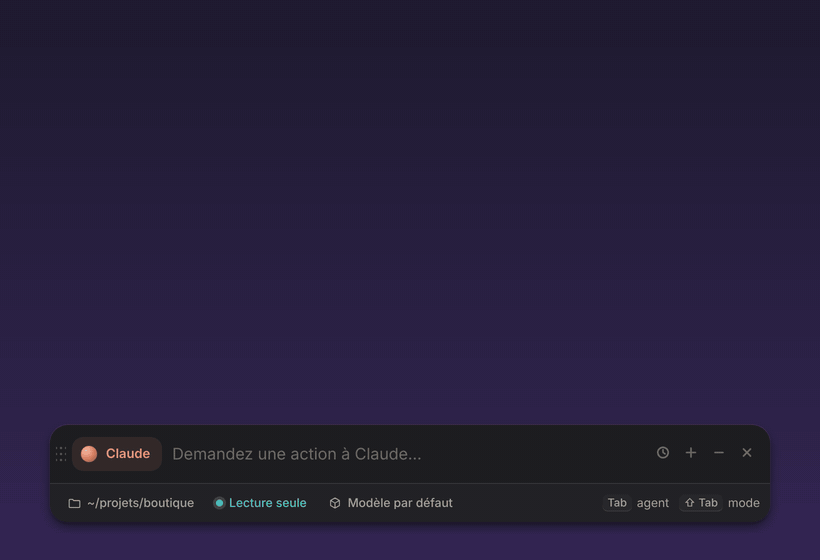
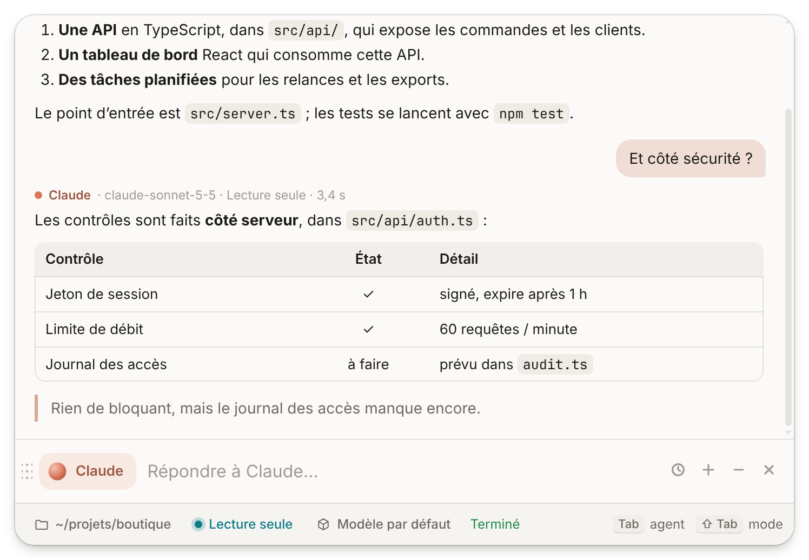
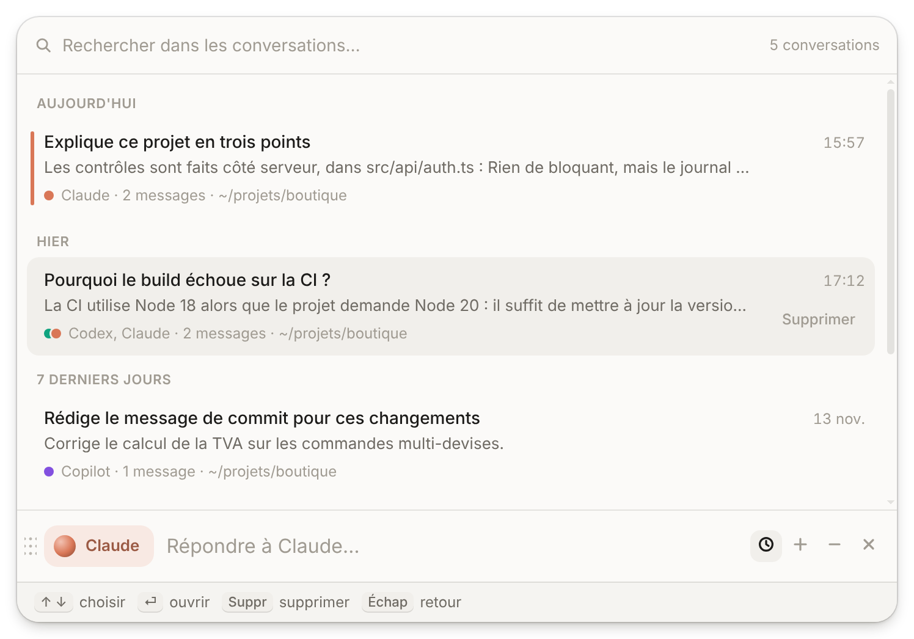
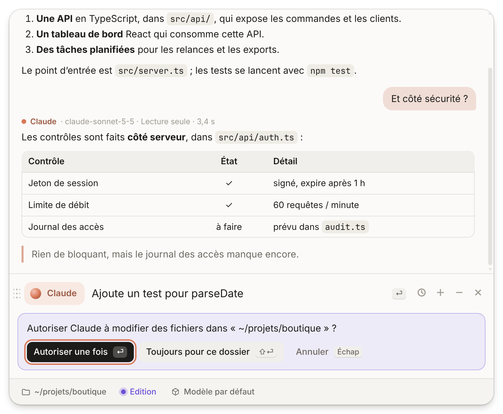
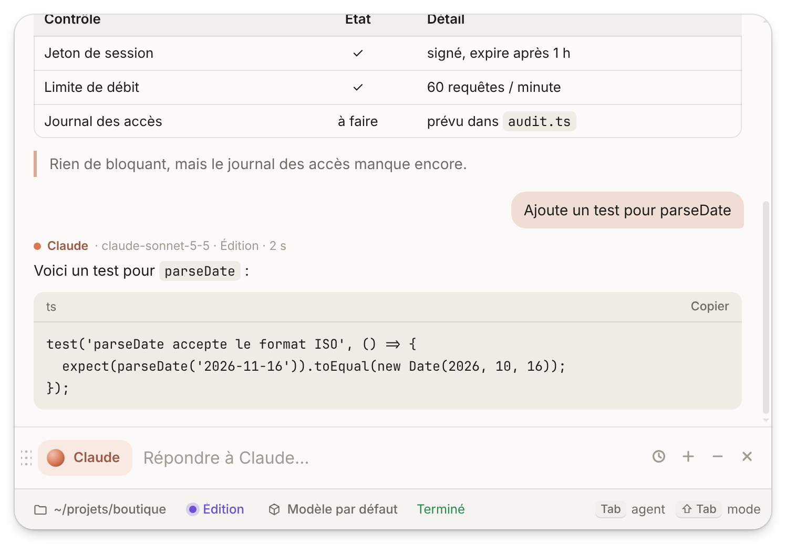

<div align="center">


# Aska

**Un raccourci, un champ, et vos agents IA répondent.**

Claude Code, Codex, GitHub Copilot et Cursor dans une seule petite fenêtre,<br>
pilotés par leurs CLI officiels. Linux et Windows.

[](https://github.com/JunsyG92/aska/actions/workflows/tests.yml)




</div>

## En bref

- ⌨️ **`Ctrl+Alt+Espace`** ouvre la fenêtre, où que vous soyez. `Tab` change d'agent, `Entrée` envoie.
- 💬 **Un vrai fil de discussion** : chaque message garde le contexte des précédents, même si vous changez d'agent en route.
- 🔌 **Vos CLI, vos comptes** : Aska n'appelle aucune API et ne stocke aucune clé. Il lance les CLI déjà installés et connectés chez vous, avec leurs MCP et leurs skills.
- 🛡️ **Lecture seule par défaut** : l'agent ne modifie rien tant que vous ne changez pas de mode, et jamais sans votre accord pour le dossier.
- 📌 **Discret ou toujours là** : un clic à l'extérieur masque le chat ; épinglé, il reste au premier plan où vous le posez. Réduit en pastille, il vous montre où en est l'agent.
- 🔔 **Prévenu dès que l'IA répond** : une notification système (agent et début de la réponse) quand le chat est masqué ou réduit ; un clic vous ramène à la conversation.
- 🌗 **Clair ou sombre**, selon le thème de votre système.

## Aperçu

<table>
<tr>
<td width="50%" valign="top">

**Réponses en Markdown**<br>
Tableaux, listes, citations, liens, et blocs de code avec un bouton « Copier ».

<picture><source media="(prefers-color-scheme: dark)" srcset="docs/chat-dark.png"></picture>

</td>
<td width="50%" valign="top">

**Historique**<br>
Conversations regroupées par date, avec aperçu, agents impliqués et recherche.

<picture><source media="(prefers-color-scheme: dark)" srcset="docs/historique-dark.png"></picture>

</td>
</tr>
<tr>
<td valign="top">

**Choix du modèle**<br>
La liste vient du CLI lui-même et se filtre au clavier.

<picture><source media="(prefers-color-scheme: dark)" srcset="docs/modeles-dark.png"></picture>

</td>
<td valign="top">

**Accord avant écriture**<br>
Modifier un dossier demande votre feu vert, une fois ou pour toujours.

<picture><source media="(prefers-color-scheme: dark)" srcset="docs/accord-dark.png"></picture>

</td>
</tr>
<tr>
<td valign="top">

**Du code prêt à copier**

<picture><source media="(prefers-color-scheme: dark)" srcset="docs/code-dark.png"></picture>

</td>
<td valign="top">

**Réduit en pastille**<br>
L'agent continue, la pastille montre où il en est.

<picture><source media="(prefers-color-scheme: dark)" srcset="docs/pastille-dark.png"></picture>

</td>
</tr>
</table>

## Installation

Il vous faut **Node.js ≥ 20** et au moins un CLI d'agent installé et connecté :

| Agent | Installation |
| --- | --- |
| Claude Code | `npm i -g @anthropic-ai/claude-code` |
| Codex | `npm i -g @openai/codex` |
| GitHub Copilot | `npm i -g @github/copilot` |
| Cursor | voir [cursor.com/cli](https://cursor.com/cli) |

### Linux

```sh
git clone https://github.com/JunsyG92/aska.git && cd aska
./scripts/install.sh                    # X11 : raccourci global Ctrl+Alt+Espace
./scripts/install.sh --gnome-shortcut   # GNOME / Wayland : raccourci enregistré dans GNOME
aska --hidden &                         # ou reconnectez-vous (démarrage automatique)
```

- **Ubuntu 24.04+** : le script propose de régler le bac à sable d'Electron (mot de passe `sudo` demandé). Sans cela, Aska ne démarre pas ; `--sandbox-fix` le fait sans poser la question.
- **Wayland** : une application ne peut pas toujours capter un raccourci global. Si `Ctrl+Alt+Espace` ne répond pas, associez la commande `aska --toggle` à un raccourci dans les paramètres clavier de votre bureau (KDE, Sway, Hyprland…) et mettez `"shortcut": false` dans la configuration.

### Windows 10 / 11

```powershell
git clone https://github.com/JunsyG92/aska.git; cd aska
powershell -ExecutionPolicy Bypass -File scripts\install.ps1
```

Aucun droit administrateur n'est nécessaire. Le script crée un raccourci « Aska » dans le menu Démarrer, lance Aska à l'ouverture de session (`-NoAutostart` pour l'éviter) et pose une commande `aska` dans `%LOCALAPPDATA%\aska\bin`.

### Vérifier l'installation

```sh
aska --help
```

L'aide liste les options, les raccourcis, et surtout **l'état de chaque agent** : le CLI trouvé et son chemin, ou la raison de son absence.

| Commande | Effet |
| --- | --- |
| `aska` / `aska --toggle` | affiche ou masque la fenêtre (démarre l'app si besoin) |
| `aska --hidden` | démarre en arrière-plan |
| `aska --reload` | relit la configuration |
| `aska --quit` | quitte |
| `aska --help` / `--version` | aide et diagnostic / version |

## Raccourcis

| Touche | Action |
| --- | --- |
| `Ctrl+Alt+Espace` | afficher / masquer la fenêtre (raccourci global, modifiable) |
| `Entrée` | envoyer · `Maj+Entrée` : nouvelle ligne |
| `Tab` | agent suivant |
| `Maj+Tab` | mode de permission suivant |
| `Ctrl+Maj+M` | choisir le modèle |
| `Ctrl+N` | nouvelle conversation |
| `Ctrl+H` | historique : taper pour rechercher, `Entrée` ouvrir, `Suppr` deux fois pour supprimer |
| `Ctrl+O` | dossier de travail (clic droit sur le dossier : retour à l'espace temporaire) |
| `↑` / `↓` | rappeler un message déjà envoyé |
| `Ctrl+Maj+C` | copier la dernière réponse |
| `Ctrl+M` | réduire en pastille / agrandir |
| `Ctrl+P` | épingler : le chat reste affiché quand vous cliquez ailleurs |
| `Échap` | annuler la demande en cours, sinon masquer |

Un clic en dehors du chat le masque ; l'agent continue de travailler. Pour le garder affiché, épinglez-le (📌 ou `Ctrl+P`) : le choix est mémorisé. Réduit en pastille, il reste toujours visible. La fenêtre se déplace par la poignée à gauche ou par la barre du bas, et sa position est mémorisée.

## Notifications

Quand une réponse arrive alors que le chat est masqué ou réduit en pastille, Aska envoie une notification système : l'agent, et le début de la réponse en texte brut (ou la cause d'un échec). Un clic sur la notification rouvre le chat sur la bonne conversation. La pastille affiche aussi « Nouvelle réponse » avec un point vert, jusqu'à ce que vous rouvriez le chat. Une demande que vous annulez ne notifie jamais.

| Option (`config.json`) | Effet |
| --- | --- |
| `"notify": "hidden"` | par défaut : quand le chat est masqué ou réduit |
| `"notify": "unfocused"` | aussi quand le chat est visible mais que vous travaillez dans une autre fenêtre |
| `"notify": "never"` | jamais |
| `"notifyPreview": false` | n'affiche pas le contenu de la réponse (écran verrouillé, partage d'écran), seulement le titre de la conversation |
| `"notifySound": false` | notification silencieuse |

Sous Windows, les notifications exigent un raccourci du menu Démarrer portant l'identité de l'application : `scripts\install.ps1` le crée.

## Conversations

- **Suite de discussion** : avec Claude, Aska reprend la session du CLI (`--resume`), qui garde tout le contexte, outils compris. Avec les autres agents, ou si vous changez d'agent en cours de fil, les échanges précédents sont réinjectés dans la demande (les plus récents d'abord, dans la limite d'environ 24 000 caractères).
- **Changer d'agent en route** : Codex peut donc poursuivre une discussion commencée avec Claude.
- **Historique** : chaque conversation est enregistrée en fichier privé (200 au plus) et se rouvre dans son dossier de travail d'origine. `"savePrompts": false` désactive tout enregistrement.

## Modèles

Le modèle se choisit par agent et le choix est mémorisé. « Par défaut du CLI » laisse l'agent décider. La liste vient du CLI lui-même, donc elle reflète votre compte et votre version :

| Agent | Source de la liste |
| --- | --- |
| Claude | les alias `opus`, `sonnet`, `haiku`, plus ceux cités par `claude --help` |
| Cursor | `cursor-agent --list-models` |
| Copilot | les choix de `--model` dans `copilot help` |
| Codex | le catalogue que Codex met en cache dans `~/.codex/` |

Le bouton ↻ réinterroge le CLI. Si un CLI ne renvoie rien, tapez le nom du modèle dans le champ de recherche (« Utiliser … ») ou déclarez vos modèles dans la configuration avec `"models"`.

## Modes de permission

Comme dans Claude Code, chaque demande s'exécute dans un mode explicite,
visible en bas du panneau. Aska démarre toujours en **Lecture seule**.

| Mode | Claude | Codex | Copilot | Cursor |
| --- | --- | --- | --- | --- |
| **Lecture seule** | `--permission-mode plan` | `--sandbox read-only` | `--deny-tool shell --deny-tool write` | `--mode ask` |
| **Édition** | `--permission-mode acceptEdits` | `--sandbox workspace-write` | `--allow-tool write --deny-tool shell` | — |
| **Autonome** (désactivé par défaut) | `--permission-mode auto` | `workspace-write` + réseau | `--allow-all-tools` + liste noire | `--force` |

- Les réglages de permission propres à chaque CLI (par ex. `~/.claude/settings.json`)
  continuent de s'appliquer : Aska n'ajoute que des restrictions.
- Le mode **Autonome** n'apparaît que si `"allowAutoMode": true`. Pour Copilot et
  Cursor il n'est pas isolé par un bac à sable : réservez-le aux dossiers jetables.
- Aucun mode n'utilise `--dangerously-skip-permissions`, `--yolo` ou équivalent,
  et ces options sont refusées si on les ajoute dans `extraArgs`.
- Cursor exige, sans interface, qu'on lui confirme la confiance dans le dossier
  (`--trust`). Aska le fait d'office dans son dossier vide ; ailleurs, il vous demande
  d'abord votre accord, même en lecture seule.
- Quand Claude signale des actions refusées, Aska l'affiche et propose de changer de mode.

## Sécurité

En résumé : **aucun shell** ne voit jamais le texte de vos demandes, l'agent ne reçoit que **les variables d'environnement qui le concernent**, il ne peut **écrire que dans un dossier que vous avez autorisé**, et l'interface est **isolée** du système.

<details>
<summary><b>Le détail des protections, et leurs limites</b></summary>

<br>

**Exécution des CLI**
- Aucun shell : le binaire est lancé avec un tableau d'arguments ; le prompt part
  sur stdin ou comme argument unique, et ne peut pas devenir une option.
- Le binaire est résolu en chemin absolu ; il est refusé s'il (ou son dossier) est
  modifiable par un autre utilisateur, et les entrées relatives du `PATH` sont ignorées.
- Environnement filtré : seules les variables de base et celles de l'agent concerné
  (`ANTHROPIC_*` pour Claude, `OPENAI_*` pour Codex…) sont transmises. Vos autres
  jetons (`AWS_*`, etc.) ne le sont pas, sauf ajout dans `envPassthrough`.
- Délai maximal, plafond de sortie, et arrêt de tout le groupe de processus
  (SIGTERM puis SIGKILL) à l'annulation.

**Dossiers**
- Par défaut l'agent travaille dans un dossier vide réservé à Aska.
- Écrire dans un dossier demande votre accord (« une fois » ou « toujours »).
- Écriture refusée dans `/`, votre `~` entier, les dossiers système et les dossiers
  sensibles (`~/.ssh`, `~/.config`, `~/.gnupg`…).

**Application**
- Interface en bac à sable, sans Node (`contextIsolation`, `sandbox`), CSP stricte,
  aucune ressource distante, navigation et nouvelles fenêtres bloquées.
- La sortie des agents est rendue en Markdown sans jamais interpréter de HTML ni charger
  d'image distante. Seuls les liens `http(s)` sont cliquables : ils s'ouvrent dans votre
  navigateur, et leur destination réelle s'affiche au survol.
- Chaque appel de l'interface est revalidé par le processus principal.
- `config.json` est ignoré s'il est modifiable par un autre utilisateur.
- Journal d'audit privé (`~/.local/state/aska/history.jsonl`, 0600) : date, agent,
  mode, dossier, commande, résultat. `"savePrompts": false` pour ne pas y écrire les
  demandes ni enregistrer les conversations.
- Les noms de modèle et identifiants de session sont validés avant d'atteindre la ligne de commande.

**Limites à connaître**
- Aska ne demande pas d'approbation action par action : la granularité est celle
  du mode choisi et des règles du CLI.
- En lecture seule, un agent peut lire tout fichier accessible à votre utilisateur
  (seul Codex isole réellement par bac à sable).
- Les options des CLI Copilot et Cursor évoluent vite ; si l'une change, corrigez-la
  dans la configuration sans attendre une mise à jour.

**Sous Windows**
- Les CLI installés par npm sont des lanceurs `.cmd`. Aska lit le lanceur et exécute directement `node.exe` sur le script visé, sans passer par `cmd.exe`, qui interpréterait `%`, `&`, `^`… dans le texte de vos demandes. Un `.cmd` d'un autre format n'est accepté que pour des arguments sans risque ; pour un agent qui reçoit la demande en argument (Copilot, Cursor), indiquez alors son `.exe` avec `"bin"` dans la configuration.
- Les vérifications de propriétaire et de droits (`600`) des fichiers n'existent pas sous Windows : Aska s'appuie sur la protection par défaut du profil utilisateur (`AppData`).
- L'écriture est refusée à la racine d'un lecteur, dans le profil entier, `AppData`, `Windows`, `Program Files` et `ProgramData`.

</details>

## Configuration

<details>
<summary><b>Toutes les options de <code>config.json</code></b></summary>

<br>

Linux : `~/.config/aska/config.json` (droits `600`). Windows : `%APPDATA%\aska\config.json`. Puis `aska --reload`.

```json
{
  "shortcut": "Control+Alt+Space",
  "defaultAgent": "claude",
  "defaultMode": "read",
  "allowAutoMode": false,
  "timeoutSec": 600,
  "maxOutputKb": 2048,
  "savePrompts": true,
  "hideOnBlur": true,
  "alwaysOnTop": true,
  "notify": "hidden",
  "notifyPreview": true,
  "notifySound": true,
  "envPassthrough": [],
  "agents": {
    "claude": { "model": "sonnet", "extraArgs": ["--max-turns", "20"] },
    "codex": { "bin": "/home/moi/.npm-global/bin/codex", "models": ["nom-du-modele-a", "nom-du-modele-b"] },
    "copilot": { "enabled": false },
    "gemini": {
      "label": "Gemini",
      "color": "#4285f4",
      "bin": "/usr/local/bin/gemini",
      "prompt": "arg",
      "promptFlag": "-p",
      "modes": { "read": ["--approval-mode", "default"] }
    }
  }
}
```

`hideOnBlur` règle le comportement par défaut au clic extérieur (`true` : le chat se masque ; `false` : il reste, comme s'il était épinglé) ; l'épingle de l'interface le change ensuite. `alwaysOnTop: false` laisse la fenêtre passer derrière les autres.

Un agent personnalisé (comme `gemini` ci-dessus) déclare son binaire en chemin
absolu et les arguments de chaque mode (`read`, `edit`, `auto`) ; `prompt` vaut
`"stdin"` ou `"arg"`.

</details>

## Dépannage

Commencez par `aska --help` : la section « Agents » dit quel CLI est utilisé, ou pourquoi il manque.

<details>
<summary><b>Problèmes connus</b></summary>

<br>

- **Ubuntu 24.04+ : « The SUID sandbox helper binary was found, but is not
  configured correctly » (arrêt par SIGTRAP)** : Ubuntu bloque le bac à sable
  d'Electron. Lancez `./scripts/install.sh --sandbox-fix` : il installe un profil
  AppArmor (`/etc/apparmor.d/aska`, mot de passe sudo demandé) qui autorise ce bac
  à sable pour le seul binaire d'Electron d'Aska. Si vous déplacez le dossier
  d'Aska, relancez la commande. Ne lancez pas Aska avec `--no-sandbox`.

- **« GitHub Copilot CLI was not found »** : la commande `copilot` trouvée est le
  lanceur installé par VS Code, pas le CLI. Installez le vrai CLI
  (`npm i -g @github/copilot`, puis `copilot` une fois dans un terminal pour vous
  connecter). S'il est installé ailleurs que dans le `PATH` de votre session
  (nvm, par exemple), indiquez son chemin : `"agents": { "copilot": { "bin": "/chemin/absolu/copilot" } }`.
- **Un agent n'apparaît pas** : même cause, son binaire n'est pas dans le `PATH`
  de la session graphique. Donnez son chemin avec `"bin"`, puis `aska --reload`.

</details>

## Développement

```sh
npm install
npm start                               # lance l'app
npm test                                # tests unitaires
xvfb-run -a npm run test:e2e            # test de bout en bout, avec de faux CLI (Windows : npm run test:e2e)
```

Chaque push lance ces tests sous Linux et Windows. Les images de cette page sont produites à partir de la vraie application par `scripts/readme-media.js`.
