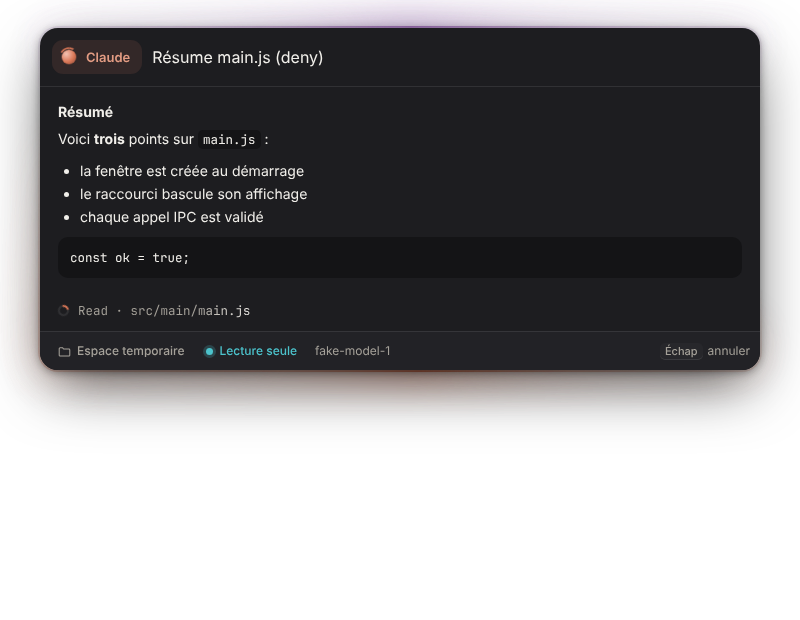

# Aska

Un raccourci clavier, un champ de saisie, et votre demande part vers l'agent IA
de votre choix **via son CLI officiel** : Claude Code, Codex, GitHub Copilot ou
Cursor. La réponse s'affiche en direct dans le même panneau.

| Sombre | Clair |
| --- | --- |
|  |  |

Aska n'appelle aucune API et ne stocke aucune clé : il pilote les CLI déjà
installés et connectés sur votre machine.

## Installation

Prérequis : Linux, Node.js ≥ 20, et au moins un CLI d'agent connecté
(`claude`, `codex`, `copilot`, `cursor-agent`).

```sh
git clone <ce dépôt> && cd aska
./scripts/install.sh                    # X11 : raccourci global Ctrl+Alt+Espace
./scripts/install.sh --gnome-shortcut   # GNOME/Wayland : raccourci enregistré dans GNOME
aska --hidden &                         # ou reconnectez-vous (démarrage automatique)
```

Sous Wayland, une application ne peut pas toujours capter un raccourci global.
Si `Ctrl+Alt+Espace` ne répond pas, associez la commande `aska --toggle` à un
raccourci dans les paramètres clavier de votre bureau (KDE, Sway, Hyprland…) et
mettez `"shortcut": false` dans la configuration.

| Commande | Effet |
| --- | --- |
| `aska` / `aska --toggle` | affiche ou masque le lanceur (démarre l'app si besoin) |
| `aska --hidden` | démarre en arrière-plan |
| `aska --reload` | relit la configuration |
| `aska --quit` | quitte |

## Utilisation

| Touche | Action |
| --- | --- |
| `Entrée` | envoyer · `Maj+Entrée` : nouvelle ligne |
| `Tab` | agent suivant |
| `Maj+Tab` | mode de permission suivant |
| `Ctrl+O` | choisir le dossier de travail (clic droit sur le dossier : retour à l'espace temporaire) |
| `↑` / `↓` | historique des demandes |
| `Ctrl+Maj+C` | copier la réponse · `Ctrl+L` : effacer |
| `Échap` | annuler l'exécution en cours, sinon fermer |

Le thème suit celui du système (clair/sombre), et les animations sont
désactivées si le système demande de réduire les mouvements. Si le panneau est
fermé pendant une exécution, une notification signale la fin.

## Modes de permission

Comme dans Claude Code, chaque demande s'exécute dans un mode explicite,
visible en bas du panneau. Aska démarre toujours en **Lecture seule**.

| Mode | Claude | Codex | Copilot | Cursor |
| --- | --- | --- | --- | --- |
| **Lecture seule** | `--permission-mode plan` | `--sandbox read-only` | `--deny-tool shell --deny-tool write` | `--mode ask` |
| **Édition** | `--permission-mode acceptEdits` | `--sandbox workspace-write` | `--allow-tool write --deny-tool shell` | — |
| **Autonome** (désactivé par défaut) | `--permission-mode auto` | `workspace-write` + réseau | `--allow-all-tools` + liste noire | `--force` |

- Les réglages de permission propres à chaque CLI (par ex. `~/.claude/settings.json`)
  continuent de s'appliquer : Aska n'ajoute que des restrictions.
- Le mode **Autonome** n'apparaît que si `"allowAutoMode": true`. Pour Copilot et
  Cursor il n'est pas isolé par un bac à sable : réservez-le aux dossiers jetables.
- Aucun mode n'utilise `--dangerously-skip-permissions`, `--yolo` ou équivalent,
  et ces options sont refusées si on les ajoute dans `extraArgs`.
- Quand Claude signale des actions refusées, Aska l'affiche et propose de changer de mode.

## Sécurité

**Exécution des CLI**
- Aucun shell : le binaire est lancé avec un tableau d'arguments ; le prompt part
  sur stdin ou comme argument unique, et ne peut pas devenir une option.
- Le binaire est résolu en chemin absolu ; il est refusé s'il (ou son dossier) est
  modifiable par un autre utilisateur, et les entrées relatives du `PATH` sont ignorées.
- Environnement filtré : seules les variables de base et celles de l'agent concerné
  (`ANTHROPIC_*` pour Claude, `OPENAI_*` pour Codex…) sont transmises. Vos autres
  jetons (`AWS_*`, etc.) ne le sont pas, sauf ajout dans `envPassthrough`.
- Délai maximal, plafond de sortie, et arrêt de tout le groupe de processus
  (SIGTERM puis SIGKILL) à l'annulation.

**Dossiers**
- Par défaut l'agent travaille dans un dossier vide réservé à Aska.
- Écrire dans un dossier demande votre accord (« une fois » ou « toujours »).
- Écriture refusée dans `/`, votre `~` entier, les dossiers système et les dossiers
  sensibles (`~/.ssh`, `~/.config`, `~/.gnupg`…).

**Application**
- Interface en bac à sable, sans Node (`contextIsolation`, `sandbox`), CSP stricte,
  aucune ressource distante, navigation et nouvelles fenêtres bloquées.
- La sortie des agents est affichée comme du texte (jamais comme du HTML), sans lien cliquable.
- Chaque appel de l'interface est revalidé par le processus principal.
- `config.json` est ignoré s'il est modifiable par un autre utilisateur.
- Journal d'audit privé (`~/.local/state/aska/history.jsonl`, 0600) : date, agent,
  mode, dossier, commande, résultat. `"savePrompts": false` pour ne pas y écrire les demandes.

**Limites à connaître**
- Aska ne demande pas d'approbation action par action : la granularité est celle
  du mode choisi et des règles du CLI.
- En lecture seule, un agent peut lire tout fichier accessible à votre utilisateur
  (seul Codex isole réellement par bac à sable).
- Les options des CLI Copilot et Cursor évoluent vite ; si l'une change, corrigez-la
  dans la configuration sans attendre une mise à jour.

## Configuration

`~/.config/aska/config.json` (droits `600`), puis `aska --reload` :

```json
{
  "shortcut": "Control+Alt+Space",
  "defaultAgent": "claude",
  "defaultMode": "read",
  "allowAutoMode": false,
  "timeoutSec": 600,
  "maxOutputKb": 2048,
  "savePrompts": true,
  "hideOnBlur": true,
  "envPassthrough": [],
  "agents": {
    "claude": { "model": "sonnet", "extraArgs": ["--max-turns", "20"] },
    "codex": { "bin": "/home/moi/.npm-global/bin/codex" },
    "copilot": { "enabled": false },
    "gemini": {
      "label": "Gemini",
      "color": "#4285f4",
      "bin": "/usr/local/bin/gemini",
      "prompt": "arg",
      "promptFlag": "-p",
      "modes": { "read": ["--approval-mode", "default"] }
    }
  }
}
```

Un agent personnalisé (comme `gemini` ci-dessus) déclare son binaire en chemin
absolu et les arguments de chaque mode (`read`, `edit`, `auto`) ; `prompt` vaut
`"stdin"` ou `"arg"`.

## Développement

```sh
npm install
npm start                               # lance l'app
npm test                                # tests unitaires (sécurité, exécution, analyse du flux)
xvfb-run -a npm run test:e2e            # test de bout en bout avec de faux CLI
```
