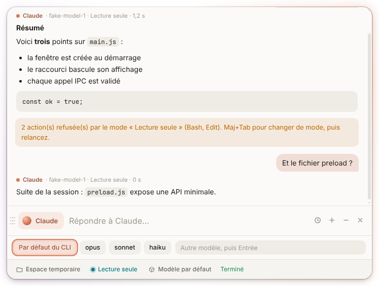
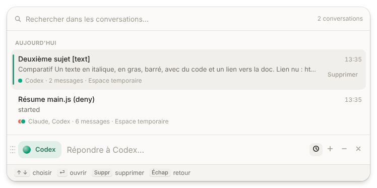

# Aska

Un raccourci clavier, un champ de saisie, et votre demande part vers l'agent IA
de votre choix **via son CLI officiel** : Claude Code, Codex, GitHub Copilot ou
Cursor. La réponse s'affiche en direct, et la discussion se poursuit comme dans
un chat : chaque message s'ajoute au fil, avec le contexte des précédents.

Le panneau est une petite fenêtre fixe : elle reste au premier plan à l'endroit
où vous la posez, et se réduit en pastille d'un clic.

| Sombre | Clair |
| --- | --- |
|  |  |
|  |  |

Aska n'appelle aucune API et ne stocke aucune clé : il pilote les CLI déjà
installés et connectés sur votre machine.

## Installation

Prérequis : Linux, Node.js ≥ 20, un accès à github.com (téléchargement d'Electron), et au moins un CLI d'agent connecté
(`claude`, `codex`, `copilot`, `cursor-agent`).

```sh
git clone <ce dépôt> && cd aska
./scripts/install.sh                    # X11 : raccourci global Ctrl+Alt+Espace
                                        # (Ubuntu 24.04+ : propose de régler le bac à sable, sudo)
./scripts/install.sh --gnome-shortcut   # GNOME/Wayland : raccourci enregistré dans GNOME
aska --hidden &                         # ou reconnectez-vous (démarrage automatique)
```

### Windows 10 / 11

Prérequis : Node.js ≥ 20 et au moins un CLI d'agent connecté. Aucun droit
administrateur n'est nécessaire.

```powershell
git clone <ce dépôt>; cd aska
powershell -ExecutionPolicy Bypass -File scripts\install.ps1   # -NoAutostart pour ne pas le lancer à l'ouverture de session
```

Le script crée un raccourci « Aska » dans le menu Démarrer, lance Aska en
arrière-plan à l'ouverture de session, et pose une commande `aska` dans
`%LOCALAPPDATA%\aska\bin` (à ajouter au `PATH` pour `aska --quit`, `aska --reload`).
La configuration est dans `%APPDATA%\aska\config.json`.

Différences avec Linux :
- Les CLI installés par npm sont des lanceurs `.cmd`. Aska lit le lanceur et
  exécute directement `node.exe` sur le script visé, sans passer par `cmd.exe`, qui
  interpréterait `%`, `&`, `^`… dans le texte de vos demandes. Un `.cmd` d'un autre
  format n'est accepté que pour des arguments sans risque ; pour un agent qui
  reçoit la demande en argument (Copilot, Cursor), indiquez alors son `.exe` avec
  `"bin"` dans la configuration.
- Les vérifications de propriétaire et de droits (`600`) des fichiers n'existent
  pas sous Windows : Aska s'appuie sur la protection par défaut du profil
  utilisateur (`AppData`).

Sous Wayland, une application ne peut pas toujours capter un raccourci global.
Si `Ctrl+Alt+Espace` ne répond pas, associez la commande `aska --toggle` à un
raccourci dans les paramètres clavier de votre bureau (KDE, Sway, Hyprland…) et
mettez `"shortcut": false` dans la configuration.

| Commande | Effet |
| --- | --- |
| `aska` / `aska --toggle` | affiche ou masque le lanceur (démarre l'app si besoin) |
| `aska --hidden` | démarre en arrière-plan |
| `aska --reload` | relit la configuration |
| `aska --quit` | quitte |
| `aska --help` | aide : options, raccourcis, agents détectés (et pourquoi un agent manque), fichiers |
| `aska --version` | version |

## Utilisation

| Touche | Action |
| --- | --- |
| `Entrée` | envoyer (le champ se vide, le message rejoint le fil) · `Maj+Entrée` : nouvelle ligne |
| `Tab` | agent suivant |
| `Maj+Tab` | mode de permission suivant |
| `Ctrl+Maj+M` | choisir le modèle de l'agent |
| `Ctrl+N` | nouvelle conversation |
| `Ctrl+H` | conversations enregistrées : taper pour rechercher, `Entrée` ouvrir, `Suppr` deux fois pour supprimer |
| `Ctrl+O` | choisir le dossier de travail (clic droit sur le dossier : retour à l'espace temporaire) |
| `↑` / `↓` | rappeler un message déjà envoyé |
| `Ctrl+Maj+C` | copier la dernière réponse |
| `Ctrl+M` | réduire en pastille / agrandir (ou le bouton `–`) |
| `Échap` | annuler l'exécution en cours, sinon masquer la fenêtre |

La fenêtre reste affichée quand vous travaillez ailleurs. Déplacez-la par la
poignée à gauche ou par la barre du bas : sa position est mémorisée. Réduite,
la pastille indique l'agent et l'état de la demande ; l'exécution continue. Le
raccourci global la rétablit, ou la masque si elle est déjà active.

Le thème suit celui du système (clair/sombre), et les animations sont
désactivées si le système demande de réduire les mouvements. Si le panneau est
masqué pendant une exécution, une notification signale la fin.

## Conversations

Les réponses sont rendues en Markdown : titres, listes imbriquées et cases à
cocher, tableaux, citations, liens, gras, italique, barré, et blocs de code avec
un bouton « Copier ».

- **Suite de discussion** : avec Claude, Aska reprend la session du CLI
  (`--resume`), qui garde tout le contexte, outils compris. Avec les autres
  agents, ou si vous changez d'agent en cours de fil, les échanges précédents
  sont réinjectés dans la demande (les plus récents d'abord, dans la limite
  d'environ 24 000 caractères).
- **Changer d'agent en cours de route** est donc possible : Codex peut
  poursuivre une discussion commencée avec Claude.
- **Historique** : chaque conversation est enregistrée dans
  `~/.local/state/aska/conversations/` (fichiers privés, 200 au plus) et se
  rouvre avec `Ctrl+H`, dans son dossier de travail d'origine. La liste est
  regroupée par date, avec un aperçu de la dernière réponse, les agents
  impliqués et une recherche (titres, aperçus, agents, dossiers).
  `"savePrompts": false` désactive tout enregistrement.

## Modèles

Le modèle se choisit par agent (`Ctrl+Maj+M` ou la pastille du bas) dans une
liste filtrable au clavier ; le choix est mémorisé. « Par défaut du CLI » laisse
l'agent décider.

La liste vient du CLI lui-même, donc elle reflète votre compte et votre version :

| Agent | Source de la liste |
| --- | --- |
| Cursor | `cursor-agent --list-models` |
| Copilot | les choix de `--model` dans `copilot help` |
| Codex | le catalogue que Codex met en cache dans `~/.codex/` |
| Claude | les alias `opus`, `sonnet`, `haiku`, plus ceux cités par `claude --help` |

Le bouton ↻ réinterroge le CLI. Si un CLI ne renvoie rien, tapez le nom du
modèle dans le champ de recherche (« Utiliser … ») ou déclarez vos modèles dans
la configuration avec `"models"`.

## Modes de permission

Comme dans Claude Code, chaque demande s'exécute dans un mode explicite,
visible en bas du panneau. Aska démarre toujours en **Lecture seule**.

| Mode | Claude | Codex | Copilot | Cursor |
| --- | --- | --- | --- | --- |
| **Lecture seule** | `--permission-mode plan` | `--sandbox read-only` | `--deny-tool shell --deny-tool write` | `--mode ask` |
| **Édition** | `--permission-mode acceptEdits` | `--sandbox workspace-write` | `--allow-tool write --deny-tool shell` | — |
| **Autonome** (désactivé par défaut) | `--permission-mode auto` | `workspace-write` + réseau | `--allow-all-tools` + liste noire | `--force` |

- Les réglages de permission propres à chaque CLI (par ex. `~/.claude/settings.json`)
  continuent de s'appliquer : Aska n'ajoute que des restrictions.
- Le mode **Autonome** n'apparaît que si `"allowAutoMode": true`. Pour Copilot et
  Cursor il n'est pas isolé par un bac à sable : réservez-le aux dossiers jetables.
- Aucun mode n'utilise `--dangerously-skip-permissions`, `--yolo` ou équivalent,
  et ces options sont refusées si on les ajoute dans `extraArgs`.
- Cursor exige, sans interface, qu'on lui confirme la confiance dans le dossier
  (`--trust`). Aska le fait d'office dans son dossier vide ; ailleurs, il vous demande
  d'abord votre accord, même en lecture seule.
- Quand Claude signale des actions refusées, Aska l'affiche et propose de changer de mode.

## Sécurité

**Exécution des CLI**
- Aucun shell : le binaire est lancé avec un tableau d'arguments ; le prompt part
  sur stdin ou comme argument unique, et ne peut pas devenir une option.
- Le binaire est résolu en chemin absolu ; il est refusé s'il (ou son dossier) est
  modifiable par un autre utilisateur, et les entrées relatives du `PATH` sont ignorées.
- Environnement filtré : seules les variables de base et celles de l'agent concerné
  (`ANTHROPIC_*` pour Claude, `OPENAI_*` pour Codex…) sont transmises. Vos autres
  jetons (`AWS_*`, etc.) ne le sont pas, sauf ajout dans `envPassthrough`.
- Délai maximal, plafond de sortie, et arrêt de tout le groupe de processus
  (SIGTERM puis SIGKILL) à l'annulation.

**Dossiers**
- Par défaut l'agent travaille dans un dossier vide réservé à Aska.
- Écrire dans un dossier demande votre accord (« une fois » ou « toujours »).
- Écriture refusée dans `/`, votre `~` entier, les dossiers système et les dossiers
  sensibles (`~/.ssh`, `~/.config`, `~/.gnupg`…).

**Application**
- Interface en bac à sable, sans Node (`contextIsolation`, `sandbox`), CSP stricte,
  aucune ressource distante, navigation et nouvelles fenêtres bloquées.
- La sortie des agents est rendue en Markdown sans jamais interpréter de HTML ni charger
  d'image distante. Seuls les liens `http(s)` sont cliquables : ils s'ouvrent dans votre
  navigateur, et leur destination réelle s'affiche au survol.
- Chaque appel de l'interface est revalidé par le processus principal.
- `config.json` est ignoré s'il est modifiable par un autre utilisateur.
- Journal d'audit privé (`~/.local/state/aska/history.jsonl`, 0600) : date, agent,
  mode, dossier, commande, résultat. `"savePrompts": false` pour ne pas y écrire les
  demandes ni enregistrer les conversations.
- Les noms de modèle et identifiants de session sont validés avant d'atteindre la ligne de commande.

**Limites à connaître**
- Aska ne demande pas d'approbation action par action : la granularité est celle
  du mode choisi et des règles du CLI.
- En lecture seule, un agent peut lire tout fichier accessible à votre utilisateur
  (seul Codex isole réellement par bac à sable).
- Les options des CLI Copilot et Cursor évoluent vite ; si l'une change, corrigez-la
  dans la configuration sans attendre une mise à jour.

## Dépannage

- **Ubuntu 24.04+ : « The SUID sandbox helper binary was found, but is not
  configured correctly » (arrêt par SIGTRAP)** : Ubuntu bloque le bac à sable
  d'Electron. Lancez `./scripts/install.sh --sandbox-fix` : il installe un profil
  AppArmor (`/etc/apparmor.d/aska`, mot de passe sudo demandé) qui autorise ce bac
  à sable pour le seul binaire d'Electron d'Aska. Si vous déplacez le dossier
  d'Aska, relancez la commande. Ne lancez pas Aska avec `--no-sandbox`.

- **« GitHub Copilot CLI was not found »** : la commande `copilot` trouvée est le
  lanceur installé par VS Code, pas le CLI. Installez le vrai CLI
  (`npm i -g @github/copilot`, puis `copilot` une fois dans un terminal pour vous
  connecter). S'il est installé ailleurs que dans le `PATH` de votre session
  (nvm, par exemple), indiquez son chemin : `"agents": { "copilot": { "bin": "/chemin/absolu/copilot" } }`.
- **Un agent n'apparaît pas** : même cause, son binaire n'est pas dans le `PATH`
  de la session graphique. Donnez son chemin avec `"bin"`, puis `aska --reload`.

## Configuration

`~/.config/aska/config.json` (droits `600`), puis `aska --reload` :

```json
{
  "shortcut": "Control+Alt+Space",
  "defaultAgent": "claude",
  "defaultMode": "read",
  "allowAutoMode": false,
  "timeoutSec": 600,
  "maxOutputKb": 2048,
  "savePrompts": true,
  "hideOnBlur": false,
  "alwaysOnTop": true,
  "envPassthrough": [],
  "agents": {
    "claude": { "model": "sonnet", "extraArgs": ["--max-turns", "20"] },
    "codex": { "bin": "/home/moi/.npm-global/bin/codex", "models": ["nom-du-modele-a", "nom-du-modele-b"] },
    "copilot": { "enabled": false },
    "gemini": {
      "label": "Gemini",
      "color": "#4285f4",
      "bin": "/usr/local/bin/gemini",
      "prompt": "arg",
      "promptFlag": "-p",
      "modes": { "read": ["--approval-mode", "default"] }
    }
  }
}
```

`hideOnBlur: true` redonne un comportement de lanceur éphémère (la fenêtre se
masque dès qu'elle perd le focus) ; `alwaysOnTop: false` la laisse passer
derrière les autres fenêtres.

Un agent personnalisé (comme `gemini` ci-dessus) déclare son binaire en chemin
absolu et les arguments de chaque mode (`read`, `edit`, `auto`) ; `prompt` vaut
`"stdin"` ou `"arg"`.

## Développement

```sh
npm install
npm start                               # lance l'app
npm test                                # tests unitaires (sécurité, exécution, analyse du flux)
xvfb-run -a npm run test:e2e            # test de bout en bout avec de faux CLI
```
